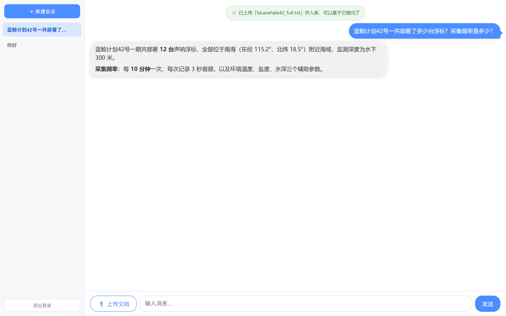
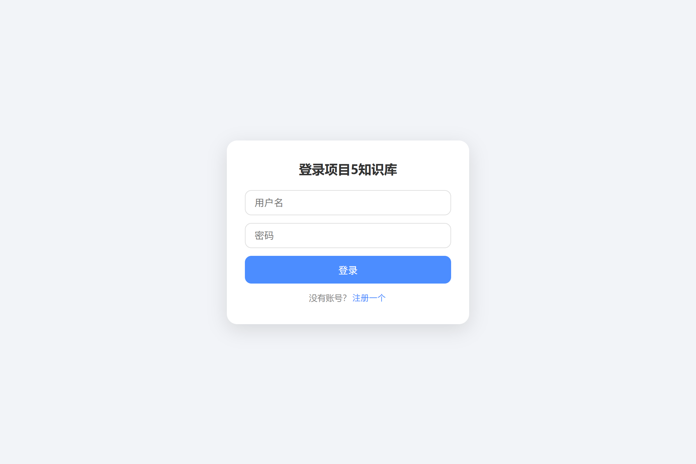
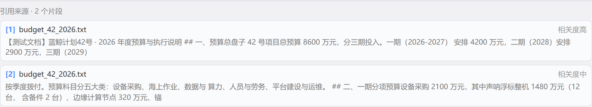

# project5 —— 全栈 AI 知识库（React 版）

RAG/Agent 链路思路参考开源项目 `LangGraph-RAG-Agent-main`；**用户系统、文档管理、会话与文档隔离、评测体系、前端与部署均为独立实现**。做成一个可部署的全栈产品：上传私有文档 → RAG/Agent 问答。React 前端 + FastAPI 后端 + LangGraph Agent + 本地向量库，Docker Compose 一键部署。

| 知识库问答（基于片段作答 + 引用溯源） | 登录页 |
|---|---|
|  |  |

引用卡片特写——每条引用标出片段来源与精排相关度（`高 ≥ 3` / `中 ≥ 1` / `低 < 1`，分档依据见第七节实测分布）：



---

## 一、项目介绍

面向个人的私有知识库问答系统：注册登录后，向会话上传文档，Agent 基于文档内容（而非全网）回答提问；问题超出文档范围时自动联网搜索。聊天带多轮记忆，流式输出，每条回答都标出引用来源。

核心亮点：**用户系统 / 文档管理 / 会话隔离** 三大模块全部打通，每个用户的文档与会话都做了归属隔离；检索走**两段式（向量粗召 → cross-encoder 精排）**，并用 26 题测试集把每一步的效果量化出来（详见第七节）。

## 二、功能展示

| 功能 | 说明 |
|---|---|
| 用户注册/登录 | 前端卡片支持「注册/登录」切换（注册成功自动登录）；JWT 鉴权，密码 bcrypt 哈希（`/api/v1/auth/*`） |
| 会话管理 | 新建会话拿到 thread_id，按用户隔离（`/api/v1/threads`） |
| 文档管理 | 上传（后台异步处理，立即返回 202）/ 列表 / 删除；支持 .docx/.pdf/.txt |
| RAG 问答 | 两段式检索（向量粗召 → cross-encoder 精排）→ Agent 基于片段生成回答，流式返回（NDJSON 打字机） |
| 引用溯源 | 每条回答下方列出引用了哪几个片段、来自哪份文档、相关度多少；引用信息走 `ToolMessage.artifact` 侧信道，不占模型上下文，刷新/切会话后仍在 |
| 联网搜索 | 检索不到时自动调用 BoCha 搜索补充 |
| 多轮记忆 | LangGraph checkpointer 存会话历史 |
| 可观测性 | 可选接入 Langfuse 面板，追踪 Agent 每次运行的 trace（技术雷达 Demo） |

## 三、技术架构

```
React 前端 (5173 / Nginx)
   │  /api/v1/*  (JWT)
   ▼
FastAPI 后端 (8001)
   ├─ users/threads/documents        资源模块
   ├─ chat  → LangGraph ReAct Agent
   │            ├─ LLM: 智谱 GLM-4-Flash(OpenAI兼容协议)
   │            ├─ tools: 文档检索(retrieve_user_documents) + 联网搜索(web_search)
   │            └─ checkpointer: SQLite 多轮记忆
   ├─ db: PostgreSQL(主库) + Chroma(向量库)
   │        └─ 检索：bge-small-zh 粗召 top-12 → bge-reranker 精排 → 取 top-3
   └─ Langfuse(可选): 回调上报 trace → 面板 8080
```

## 四、技术选型

| 层 | 选型 | 说明 |
|---|---|---|
| 后端 | FastAPI + SQLAlchemy(async) | 异步全栈，自动文档 |
| Agent | LangGraph `create_agent` | ReAct：推理 + 工具调用循环 |
| LLM | 智谱 GLM-4-Flash（免费档） | OpenAI 兼容协议，ChatOpenAI 接入；换服务商只改 `config.py` 三个值，业务代码不动 |
| Embedding | bge-small-zh-v1.5 | 本地模型（fastembed/ONNX，512 维），中文效果好、免费无 key、不用装 torch |
| 精排 | bge-reranker-v2-m3-int8 | cross-encoder 交叉编码，本地 ONNX 推理；把「话题相关」校正成「真的含答案」 |
| 向量库 | Chroma | 文档切片向量检索 |
| 主库 | PostgreSQL 16 | 用户/会话/文档表单据 |
| 记忆 | AsyncSqliteSaver | LangGraph 检查点，本地 .sqlite |
| 搜索工具 | BoCha（博查） | 联网补全 |
| 前端 | React 19 + Vite | 流式渲染、Markdown+代码高亮 |
| 鉴权 | JWT(pyjwt) + bcrypt | FastAPI 依赖注入 |
| 观测 | Langfuse（自托管） | 技术雷达 Demo，可选 |
| 部署 | Docker Compose | backend+frontend+postgres 三条服务 |

## 五、部署方式

前置条件：Docker Desktop；项目根 `.env` 配 `LLM_API_KEY` / `BOCHA_API_KEY`（见 `.env.example`）。LLM 默认接智谱 GLM-4-Flash（免费档，申请即用）；换 DeepSeek/OpenAI 只改 `config.py` 三个值，业务代码不动。

```bash
docker compose up -d --build    # 后端起 8001，前端起 5173，Postgres 起 5434（避开 project6 的 5432）
```

| 服务 | 对外端口 | 容器内 | 说明 |
|---|---|---|---|
| backend | 8001 | 8000 | FastAPI + Agent + Chroma |
| frontend | 5173 | 80 | React 静态站（Nginx 反代 /api） |
| postgres | 5434 | 5432 | 主数据库（宿主机 5434，避开 project6 的 5432） |

**Windows 一键启动（日常用这个）**：双击项目根目录的 `启动.bat` —— 自动拉起 Docker、启动全部服务（含面板）、就绪后自动打开浏览器；已在运行时会秒过。

**本地开发**（不用 Docker）：

```bash
# 后端（backend/ 目录；用项目根统一 venv；8001 对齐 vite 代理）
..\.venv\Scripts\python.exe -m uvicorn app.main:app --port 8001
# 前端（frontend/react-app/ 目录）
npm install && npm run dev     # http://localhost:5173
```

**可选：Langfuse 可观测性面板**

```bash
docker compose -f docker-compose.langfuse.yml up -d   # 面板 http://localhost:8080
```

数据安全：Chroma / SQLite / 上传文档在 `./outputs`（挂载卷，容器删除不丢）；embedding 模型缓存走命名卷；密钥只经环境变量透传，不写入镜像。

## 六、遇到的问题（排坑记录）

| 问题 | 根因 | 解决 |
|---|---|---|
| 后端启动 Connection refused | config 连接串写死 `localhost`，容器内指不到 postgres | 加 `database_host` 配置项，compose 注入服务名 `postgres` |
| docker compose 起不来（Exited 255） | 本机 5432 被 project6 的 pgvector 占用，postgres 一映射就冲突；config 里端口还写死 | 映射改 `5434:5432`，`config.py` 抽 `database_port`（裸机 .env=5434 / 容器内注入 5432），两项目可同跑 |
| Dockerfile COPY nginx.conf 失败 | COPY 行尾中文注释触发 buildkit 解析异常 | 注释移到文件头部，指令行保持纯 ASCII |
| 前端构建失败 `react-markdown` 解析错误 | package.json 漏声明依赖 | 补装 `react-markdown` + `rehype-highlight` |
| Langfuse SDK 4.x 上报 404 | 新 SDK 走 OTLP，v2 服务器不认 | 降级 SDK 2.55.0 + 自写回调 handler |
| **回答一次性蹦出，没有打字机** | `build_retrieval_graph` 调 `create_model()` 时漏传 `streaming`（默认 `False`），而 langchain-core 对"显式传 False"是**硬禁用**流式，一个 token 回调都没有 | 显式传 `streaming=True`（`chat/langgraph_agent.py`） |
| **传了 `streaming=True` 仍不逐字** | langgraph 1.2.11 的 `create_agent` 把 model 节点标了 `trace=False`，token 事件不会变成 `stream_mode="messages"` 事件 —— 150 字的回答只收到 1 个 chunk | 不再依赖 messages 模式：新增 `TokenPump` 回调把 token 泵进队列，与 `updates` 流合并（`chat/service.py`）。实测 1 → 138 个分片、网络层 1.6s 铺开，NDJSON 协议不变、前端零改动 |
| **前端只有登录卡片，没有注册入口** | 前端一直没做注册 UI（后端 `/auth/register` 可用），新用户无法从界面进入 | 登录卡片加「注册/登录」切换：注册成功自动登录；409 透传后端文案、422 给表单规则提示（`App.jsx`） |
| **部署后普通刷新还是旧页面** | `index.html` 无缓存头 → 浏览器启发式缓存，仍加载旧 bundle（旧条目连请求都不发） | nginx：`index.html` 加 `no-cache`、带 hash 的 `/assets/` 长缓存（`nginx.conf`）；已缓存的旧条目强刷一次即完成过渡 |
| **登录后找不到退出/登录入口** | 前端没有退出按钮；localStorage 有 token 就直接渲染主界面（不校验有效性、没有出口），残留旧 token 会把用户"困"在空主界面 | 侧边栏加「退出登录」（回登录形态卡片）；`fetchThreads` 收 401 自动清 token 回登录卡片（`App.jsx` / `ThreadList.jsx`） |
| **一键启动脚本双击报"不是内部或外部命令"** | cmd 解析 .bat 用系统 ANSI 码页（中文 Windows=GBK），且只认 CRLF 行尾；UTF-8 + LF 的中文脚本会被错行拆解 | `启动.bat` 存为 GBK + CRLF；在 VSCode 里显示乱码属正常现象，不影响双击运行 |
| **精排模型下载"成功"但加载报 `Could not load model from any source`** | HuggingFace 先写 `blobs/`（数据是完整的 570MB），再在 `snapshots/<commit>/` 建软链接指向 blob；Windows 非管理员 / 未开开发者模式时建软链接失败，只留下 0 字节空壳 | 读 `trees/<commit>.json` 里的 `blob_id` / `lfs_sha256` 映射，用**硬链接**挂回 snapshots。封装成 `backend/tools/fix_hf_cache.py`，换模型不用再手工补 |
| **开了精排后单次检索 3.7 秒，页面像卡住** | 交叉编码每对 (query, 片段) 都要跑一次前向，且耗时随**输入长度**涨得比条数凶（35 字片段 13ms/条，345 字片段 169ms/条） | ①`asyncio.to_thread` 丢线程池，避免卡事件循环；②粗召池从 18 收到 12（MRR 只差 0.015，耗时少 1/3）；③**`batch_size=1` 反而最快**——批处理会把一批片段补齐到最长那条，短片段全在做无用计算，实测 12 条切片 bs=64 要 2029ms、bs=1 只要 863ms（2.35×）。最终 3.7s → 0.96s |
| **上传文档后立刻提问，答案时好时坏、两次跑分数不一样** | 索引是 `BackgroundTasks` 后台任务，上传接口立刻返回 `processing`，此时库里只有部分切片甚至没有 | 前端等「已入库，可以基于它提问了」的系统消息再放行；冒烟脚本轮询 `GET /documents/{thread_id}` 到 `status=ready` 再提问 |
| **引用卡片显示"相似度 -0.481"** | 精排分是 cross-encoder 的 logits（可正可负、无上界），不是 0~1 的余弦相似度；前端沿用了 `<0.45 打淡色` 的余弦判据 | 后端 `sources` 增 `score_type` 字段，前端按类型分流：cosine 显示数值，rerank 显示高/中/低标签（分档依据见第七节） |

## 七、RAG 评估（工程化）

评估体系在 `backend/eval/`，一套语料 + 一套测试集 + 两套指标：

```
backend/eval/
├── test_set.json         测试集 26 题：单点事实 / 多跳跨片段 / 无答案（陷阱题）
├── retrieval_eval.py     检索评估：doc_hit@k / chunk_hit@k / MRR / 拒答两错率 + 阈值扫描
└── generation_eval.py    生成评估：LLM-as-Judge（正确性 / 忠实度）
```

评估语料是 `test_docs/` 下 8 份主题相近的合成文档（蓝鲸计划 41/42 号、设备手册、预算、运维记录、平台规范等），共 45 个切片。**主题高度重叠**是有意设计的——这样才能压出"向量检索把同话题但不含答案的片段排前面"这类真实问题。

### 7.1 为什么主指标是 doc_hit 而不是 chunk_hit

`chunk_hit` 在 k 固定时会随切片变小而机械下跌：切片越碎，top-k 覆盖的文字总量越少，关键词越难被覆盖。实测跌幅几乎完全等于覆盖率跌幅（切片长度 1000→380 字，覆盖率比值 0.38，实测指标比值 0.385），这是**数学稀释**，不是检索变差。所以跨切分策略比较只看 `doc_hit@k`（答案所在整份文档有没有被捞出来），这个指标不受切片大小影响。

### 7.2 当前基线（8 份语料 / 45 切片 / 26 题 / k=3）

| 指标 | 关精排 | **开精排（生产默认）** | 说明 |
|---|---|---|---|
| doc_hit@3 | 0.6957 | **0.7826** | top-3 是否覆盖答案所在文档 |
| chunk_hit@3 | 0.6087 | **0.9565** | top-3 是否有片段含答案关键词 |
| MRR | 0.4928 | **0.8261** | 首个命中片段的排名倒数均值 |
| 无答案题假阳率 | 1.0（3/3） | **0.3333（1/3）** | 没资料却硬答的比例 |
| 有答案题假阴率 | 0.0 | 0.0 | 有资料却说没有的比例 |
| 检索耗时 | 4 ms | 0.96 s | 单次查询，CPU/ONNX |

生成评估（LLM-as-Judge，**26 题全量** / k=3 / 走生产同一个 `query_with_sources` 检索入口）：平均正确性 **3.85 / 5**、平均忠实度 **4.04 / 5**。

> ⚠️ 两组分数不要混着看：上表是**检索层**指标，跟用哪个大模型无关；这行是**生成层**指标。
> 也不能和早期 DeepSeek 版的 5.0 / 4.7 直接比 —— 这次被测模型和判分模型**同时**从 DeepSeek 换成了免费的智谱 GLM-4-Flash（原 key 余额耗尽），判分尺度跟着变（判分器倾向于认可同风格的输出）。换模型只为让任何人 clone 下来都能零成本复现评估。

低分题（7/26）逐题人工过了一遍，分三类，指向完全不同的修法：

| 类型 | 题号 | 现象 | 归因 |
|---|---|---|---|
| 相似文档数字混淆 | #3 #7 | 42 号续航答 240 天（应 180）、41 号答 180 天（应 240），**两题正好互换** | 41/42 号两份项目文档高度同源，免费模型对相邻上下文的区分力弱于 DeepSeek；不是检索没捞到 |
| 检索未覆盖 | #2 #15 | 模型如实答"资料中未提及"42 号采样频率 | 该事实所在切片没进 top-3。答"不知道"是忠实度的正确表现，但正确性扣分 |
| 抽象归纳丢细节 | #16 | 把"磷酸铁锂 / 锂亚硫酰氯"归纳成"充电 / 一次性电池" | 模型为规避编造而过度抽象，术语信息量下降 |

三类对应三条可下手的方向：①同源多版本文档做元数据消歧（曾试过给切片加"文档身份前缀"，是负结果——把同文档切片捆在一起反而挤掉别家，已默认关闭）②最终 top-k 从 3 提到 5，补多跳题的召回（代价是上下文变长、更容易被无关片段带偏）③prompt 明确要求"保留原文术语，不要归纳成上位词"。

> 换模型的隐藏成本：改 `model_name` 只是第一步。GLM-4-Flash 在"决定调工具"的那一轮会把内心独白写进正文（DeepSeek 那一轮正文是空的），前端就成了「我需要查一下…」接答案。修法是在 system prompt 里加输出风格约束，但**位置很关键**：第一版放在"关键约束"第一条，模型直接不调工具了、改口答"无法回答"；挪到最后一条、把措辞从"不要输出行动计划"改成"调用工具的回合不要附带过程说明"，才既保留工具调用又去掉废话。同一套 RAG 管线换模型，prompt 是要重新对齐的。
>
> 光靠 prompt 还**不稳定**：默认采样温度下同一问题跑 3 次，1 次啰嗦（52 个 chunk）、2 次干净（12 个）。把聊天温度降到 `0.3`（`settings.llm_temperature`）后连跑 3 次全部干净 —— RAG 要的是"照资料说"，本来也不需要创造性。生成评估不受影响，它显式传了 `temperature=0.2`。

### 7.3 一轮完整实验记录（每次只改一个变量）

| 轮次 | 改动 | doc_hit@3 | chunk_hit@3 | MRR |
|---|---|---|---|---|
| 1 | 固定长度硬切 1000/200 + 英文 minilm | 0.5217 | 0.5652 | 0.4348 |
| 2 | 按句读递归切 400/60 + 英文 minilm | 0.6087 | 0.2174 | 0.1667 |
| 3 | 换中文 bge-small-zh（512 维） | **0.6957** | **0.6087** | **0.4928** |
| 4 | 加 cross-encoder 精排（两段式） | **0.7826** | **1.0000** | **0.8478** |

几个结论值得记下来：

> 口径说明：本节表格与 7.5 的池子扫描都**未启用低分丢弃**（`--no-min-score`），这样四轮同口径可比；7.2 报的是加了丢弃后的生产配置，所以 chunk_hit 是 0.9565 而不是 1.0000。

- **第 1→2 轮 chunk_hit 大跌是"假跌"**：切片从 17 片变 45 片，k 固定为 3 时覆盖率只剩 38%，指标跌了 61%。只有 `doc_hit` 跨轮次可比。
- **第 3 轮换中文模型是收益最大的一步**：中文语料上用英文 all-MiniLM，chunk_hit 只有 0.2174；换 bge-small-zh 后涨到 0.6087，MRR 涨 0.33。
- **第 4 轮精排把 chunk_hit 打到 1.0**：向量只能判断"话题相关"，判断不了"这段里有没有答案"。

### 7.4 为什么必须上精排：一次失败的阈值实验

原本想用"相似度低于阈值就拒答"来防幻觉。实测直接宣告这条路不可行——bge-small-zh 下的分数分布：

| | 有答案的题（top-1 分） | 无答案的题（top-1 分） | 间隔 |
|---|---|---|---|
| 英文 minilm | 0.4197 ~ 0.6578（中位 0.504） | 0.4572 ~ 0.4773 | −0.0576 |
| 中文 bge | 0.6001 ~ 0.7748（中位 0.691） | 0.6277 ~ 0.7286 | **−0.1285** |

**无答案题的分数比有答案题的中位数还高**，阈值从 0.30 扫到 0.60 七档结果完全一样（假阳 3/3）。根因是"语义相似 ≠ 包含答案"：模型中文理解越强，越能把"讲 42 号项目"的片段找出来，但答案确实不在里面。

交叉编码把 query 和片段拼在一起看，能判断"这段到底答没答这个问题"。精排后分布变成：有答案 0.975~6.658，无答案 −0.849/−0.609/0.925，**首次可以被一条阈值分开**（阈值 1.0 时假阳 0/3、假阴 1/23）。不过无答案题只有 3 道，样本量撑不起线上阈值决策，所以目前只用它做两件事：丢掉确定无关的片段（`rerank_min_score`）和给引用卡片分档。

### 7.5 粗召池大小怎么定

精排要先多捞一批候选，池子太小对的片段轮不到上场，太大纯烧 CPU：

| 粗召条数 | doc_hit@3 | chunk_hit@3 | MRR |
|---|---|---|---|
| 3（等于纯向量） | 0.6957 | 0.6087 | 0.5362 |
| 6 | 0.7391 | 0.8696 | 0.7464 |
| 9 | 0.7826 | 0.9130 | 0.7826 |
| **12（默认）** | **0.7826** | **1.0000** | **0.8478** |
| 18 | 0.7826 | 0.9565 | 0.8623 |

12 比 18 只差 0.015 MRR，耗时少 1/3，所以默认 `k*4` 而不是常见的 `k*6`。

#### 顺带试过：k 从 3 加到 5 —— k 不是瓶颈

多跳题的 `doc_hit` 一直是 0（5 道全灭），直觉上会怀疑"k=3 装不下两份文档"。实测这个直觉不成立，而且先踩了两个坑：

| 配置 | doc_hit | chunk_hit | MRR | 多跳 doc_hit | 实际返回 |
|---|---|---|---|---|---|
| k=3（生产） | 0.7826 | 0.9565 | 0.8261 | 0.0 | 78/78 |
| k=5，池 12 | 0.7826 | 0.9565 | 0.8261 | 0.0 | **83/130** |
| k=5，池 12，不丢低分 | 0.7826 | 1.0000 | 0.8478 | 0.0 | 130/130 |
| k=5，池 12，不丢 + 每文档≤2 | **0.8261** | 1.0000 | 0.8478 | **0.2** | 130/130 |
| k=5，池 20，不丢 + 每文档≤2 | 0.8261 | 1.0000 | 0.8442 | 0.2 | 130/130 |

**坑一：`k=5` 可能根本没生效。** `rerank_min_score=0` 会丢掉负分片段，26 题只凑出 83/130 条，有 5 道题只剩 1 条 —— k 设成 5 和设成 3 的指标一字不差，差点被当成"加大 k 没用"。**加 k 之前先看 `chunks_returned`。**

**坑二：不加多样性约束时，k 多出来的容量全被同一份文档吃掉。** 5 道多跳题的 top-5 **每一道都有重复占位**，而 gold 里缺的那份文档进 top-5 的次数是 **0**：

| 题号 | 需要 | top-5 实际 |
|---|---|---|
| #15 | 41号 + 42号 | 41号×2、survey、platform×2 |
| #16 | 41号 + 42号 | 41号×2、sonar×3 |
| #26 | survey + 手册 | survey×3、41号×2 |

加上「每文档最多 2 位」（`--quota 2`）后 #16 被救回，多跳从 0/5 变 1/5 —— 位置腾出来就立刻有用。池子从 12 加到 20 没有额外收益、MRR 反而微跌 0.0036，说明不是召回深度不够。

**剩下 4 道的病根是 41/42 两份同构文档分不开，跟 k 无关。** 直接查 #15 的召回：`bluewhale42_full.txt` 在纯向量 top-20 里排 14/15/18，41 号占了前 8 位里的 5 个；精排后 42 号被压到 13/15/20。「41号」「42号」一字之差，向量几乎无感 —— 这类**精确标识符匹配是关键词检索（BM25 / 全文索引）的活**，纯向量做不了。这也是 project6 上混合检索（pgvector + tsvector + RRF 融合）的原因。

**所以配额没有设成生产默认。** 单独打开它（k 保持 3）实测零收益：doc_hit / chunk_hit / mrr 一字不差，却把每题证据从 3 条降到 61/78 条 —— 瓶颈是「第二份文档压根没进候选池」，腾出名额也没东西可放。它只在 `k=5 + 不丢低分` 时才有 +0.043，而那个收益只来自 1 道题（#16），统计上撑不住，还要把此前丢掉的负分片段加回来。开关留在 `settings.retrieval_per_doc_limit`（默认 0 = 关闭），将来真要调大 k 时再一起评估。

### 7.6 引用分档的依据

引用卡片上的「高/中/低」不是拍脑袋定的。实测所有题返回片段的精排分：**含答案的片段**中位数 3.83、p10 2.67；**不含答案的片段**中位数 1.74。所以 `高 ≥ 3`（明确命中）、`中 ≥ 1`（沾边）、`低 < 1`（基本无关）。低档不设成 `< 0`，因为 `rerank_min_score=0` 已经把负分片段丢掉了，那样这个档位永远显示不出来。

### 7.7 复现方式

```bash
cd backend
# 检索评估（不需要调 LLM，随便跑）
..\.venv\Scripts\python.exe -m eval.retrieval_eval --rerank                    # 生产配置
..\.venv\Scripts\python.exe -m eval.retrieval_eval --no-rerank                 # 关精排对照
..\.venv\Scripts\python.exe -m eval.retrieval_eval --rerank --recall-n 9       # 改粗召池
..\.venv\Scripts\python.exe -m eval.retrieval_eval --rerank --k 5 --no-min-score            # 加 k（先关丢弃，否则凑不满）
..\.venv\Scripts\python.exe -m eval.retrieval_eval --rerank --k 5 --no-min-score --quota 2   # 加 k + 每文档≤2 位
..\.venv\Scripts\python.exe -m eval.retrieval_eval --rerank --no-min-score     # 不丢低分片段
..\.venv\Scripts\python.exe -m eval.retrieval_eval --rerank --rerank-model BAAI/bge-reranker-base  # 换精排模型

# 生成评估（LLM-as-Judge，每题 2 次 LLM 调用；默认智谱 GLM-4-Flash 免费档，无需充值）
..\.venv\Scripts\python.exe -m eval.generation_eval                # 全部跑完
..\.venv\Scripts\python.exe -m eval.generation_eval --limit 5      # 只跑 5 题
..\.venv\Scripts\python.exe -m eval.generation_eval --rerun        # 丢掉旧结果重跑
```

生成评估是**断点续跑**的：每答完一题立刻落盘到 `reports/generation_<模型名>.json`，重跑时自动跳过已完成的题号。所以要调 LLM 的评估不怕中途断（余额不足 / 限流 / 网络抖动很常见），补上余额再跑同一条命令就从断点继续，前面已经花掉的钱不会白花。

换大模型只动三处，业务代码一行不改：`.env` 的 `LLM_API_KEY`、`backend/app/config.py` 的 `model_name` 和 `model_base_url`（三者都是 OpenAI 兼容协议）。报告名带模型名，所以换模型不会覆盖旧结果，可以直接并排看差异。

每次运行会把完整结果写进 `backend/eval/reports/`（含每题的命中情况、分数、阈值扫描表），不同配置的报告名带 `_nor` / `_rr` / `_rr9` 等后缀，可以并存对照。


## API 概览

- `POST /api/v1/auth/register` —— 注册（username + password）
- `POST /api/v1/auth/login` —— 登录，拿 JWT（24h 有效）
- 后续请求带 `Authorization: Bearer <token>`
- `POST /api/v1/threads` —— 新建会话（返回 thread_id）
- `GET /api/v1/chat/{thread_id}` —— 查会话历史
- `POST /api/v1/chat/{thread_id}` —— 发消息，流式返回 NDJSON
- `POST /api/v1/documents/upload/{thread_id}` —— 上传文档（202 后台处理）
- `GET /api/v1/documents/{thread_id}` —— 列会话下文档
- `DELETE /api/v1/documents/{document_id}` —— 删文档（含向量切片）
- `GET /health` —— 健康检查

聊天/文档/会话接口全部受 JWT 保护，未登录返回 401。